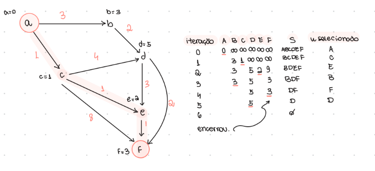
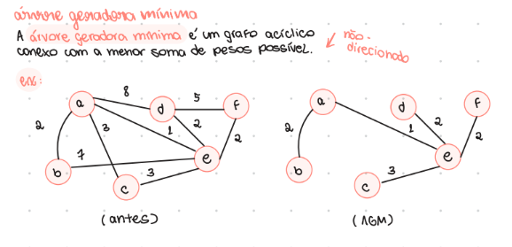
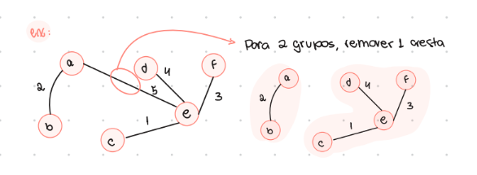
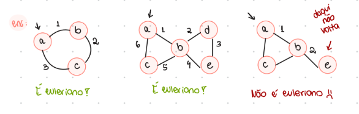
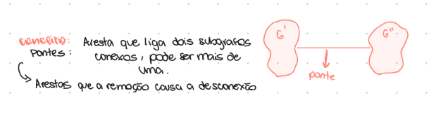

# 🕸️ Grafos -> Prova 02

## Observações 
- A definição utilizada nesse documento é a do professor Silvio.

## Djikstra 
O algoritmo de djikstra é utilizado quando temos W:E -> Z+, isto é, uma função que mapeia o conjunto de arestas em algum conjunto. Nesse caso, é o de inteiros positivos. Logo, usamos djikstra para descobrir o menor caminho entre dois vértices, considerando como critério as arestas ponderadas.    

Ele segue a mesma ideia da **ordenação topológica**, vista na p1. No caso dos inteiros positivos, mesmo podendo ter ciclos, os clicos não irão atrapalhar, pois o menor caminho não irá passar diversas vezes no mesmo ciclo, uma vez que por serem valores positivos, sempre iria aumentar a soma de pesos. 

**Algoritmo explicado**

```java
public int dijkstra(List<List<Aresta>> grafo, int origem, int destino) {
    int[] d = new int[grafo.size()];
    Arrays.fill(d, Integer.MAX_VALUE);
    d[origem] = 0;
    
    Set<Integer> naoVisitados = new HashSet<>();
    for (int i = 0; i < grafo.size(); i++) naoVisitados.add(i);

    while (!naoVisitados.isEmpty()) {
        // Encontra o vértice com a menor distância
        int u = -1, min = Integer.MAX_VALUE;
        for (int i : naoVisitados) if (d[i] < min) min = d[u = i];
        
        // Para se não há mais caminhos ou se chegou no destino
        if (u == -1 || u == destino) break;
        naoVisitados.remove(u);

        // Atualiza a distância dos vizinhos
        for (Aresta a : grafo.get(u)) {
            if (naoVisitados.contains(a.destino)) {
                d[a.destino] = Math.min(d[a.destino], d[u] + a.peso);
            }
        }
    }
    
    return d[destino]; // Retorna o menor custo até o destino
}
```



**Obs 01:** O algoritmo de djikstra funciona apenas para PESOS POSITIVOS. Isso inclui grafos acíclicos e grafos cíclicos com ciclos positivos. Ciclos positivos são ciclos que após uma volta completa, tem um valor arrecadado positivo.     

**Obs 02:** Não é possível **conceitualmente** encontrar o menor caminho em grafos cíclicos com pesos negativos. Isso porque, como cada iteração e volta no ciclo diminui mais o peso, ficaria - infinito. É um problema conceitual.   

### Adaptação 
Podemos adaptar o algoritmo de djikstra para que ele percorra todas as arestas, mesmo após chegar no vértice destino. Assim, não seria mais djikstra, mas funcionaria para acíclicos positivos, negativos e cíclicos com pesos positivos.   
**Nada funciona para cíclicos com ciclos negativos**

Mas, e como fazer para grafos cíclicos com pesos positivos e negativos?   

### Grafos cíclicos, com pesos positivos e negativos e ciclos positivos 

Em alguns casos, o algoritmo de Djikstra não irá conseguir resolver, pois quando se trata de pesos negativos, ele nem sempre funciona. Isso porque djikstra não visita necessariamente todas as arestas do grafo. 

Então, para resolver esse caso em específico, temos algumas soluções: 

**Solução 01 -> Permutação**
Permutar todos os caminhos possíveis usando permutação de vértices. Funciona, mas a complexidade seria muito ruim. 

**Solução 02 -> Repetir arestas**
Na iteração x, todos os vértices com x arestas do v inicial já foram atingidos.   
O algoritmo para quando não houver nenhuma alteração de uma iteração para outra. Isso significa que o tamanho do maior caminho é o valor da última iteração e todos os valores já foram devidamente corrigidos.    
Com essa solução, verificamos mais de uma vez a mesma aresta, mas é bem melhor do que resolver com permutação.   

Veja a seguir alguns exemplos:   

---

## Domínio e Funções 

Dado: F: A -> B   

- Chamamos de **domínio** de onde a função está vindo (A)
- Chamamos de **contradomínio** para onde está indo (B)

Para onde a função está indo é chamada de **imagem** caso todos os elementos de A tenham sido mapeados em B.   

### Função total vs parcial 
Chamamos de **função total** quando todos os elementos do meu domínio são mapeados no meu contradomínio. Na **função parcial**, alguns elementos do domínio não são mapeados no contradomínio.   

W:E -> [1,|E|] é uma função total pois todas as arestas são mapeadas, de acordo com a ordem (quantidade total de arestas).    

### Injetora vs Sobrejetora vs Bijetora 

- **Função Injetora:** Cada elemento do contradomínio recebe no máximo uma ligação. Valores diferentes de x sempre geram resultados diferentes de y. Podem sobrar elementos no conjunto de chegada (contradomínio) sem nenhum correspondente, mas nenhum valor de y será resultado de dois valores diferentes de x.

W:E -> [1,|E|] ou W:E -> Z+ não são funcões com garantia de que são injetoras, porque nesses casos, arestas diferentes podem ser mapeadas com o mesmo valor.    

No brasileirão ou nas eleicões, por exemplo, temos funções injetoras. No pior dos casos, o brasileirão desempata por sorteio, e as eleições, por idade.   

- **Função Sobrejetora:** Todo elemento do contradomínio recebe pelo menos uma ligação. Nenhum elemento sobra sozinho no conjunto de chegada (ou seja, a imagem é igual ao contradomínio), mas um mesmo valor de y pode ser gerado por mais de um valor de x.

Nessas funções, conseguimos trazer de volta (auditoria). Isso faz com que elas sejam explicáveis. Árvores de decisão, por exemplo, podem ser mapeadas de volta. Se eu tenho elementos que eu não mapeio, não consigo trazer de volta.   

- **Função Bijetora:** É a combinação de ambas. Cada elemento do contradomínio recebe exatamente uma ligação. Não sobra nenhum elemento sem par no conjunto de chegada, e não há resultados repetidos. É um pareamento perfeito e exclusivo de um-para-um entre os dois conjuntos.

**Obs:** É importante ressaltar que além de pesos em arestas, também podemos ter pesos em vértices. Eles podem ser restrições, limites, importância, prioridade, capacidade máxima, entre outros. 

---

## Árvore Geradora Mínima
Uma **árvore geradora mínima** é um grafo acíclico conexo não-direcionado com a menor soma de pesos possível. Em grafos direcionados, temos o conceito de **arborescência**. Mas é bem mais complexo.  



Tendo uma AGM, conseguimos separar um grafo em K grupos, removendo k-1 arestas. Se quisermos os melhores grupos, podemos começar removendo as arestas de maior peso.     



**Obs:** Também podemos ter uma **árvore geradora máxima**, que é um grafo acíclico conexo não-direcionado com a maior soma de pesos possível.   

Para achar uma AGM, temos diversos métodos. Alguns deles estão listados a seguir: 
**Obs:** Se for possível repetir pesos de arestas, nem sempre a AGM será única!   

*Algoritmos para achar a AGM:*
- Prim -> Djikstra sem acúmulo de peso
- Remoção reversa -> Identificar ciclos e remover arestas de maior peso
- Kruskal -> Partindo de um grafo nulo, selecionar arestas de menor peso que conectem componentes conexos diferentes 

É importante ressaltar que por mais que Djikstra não funciona para pesos negativos, todos esses algoritmos, incluindo Prim, funcionam. Isso porque não há *acúmulo de pesos*.    

---

## Grafos Eulerianos
Grafo em que é possível caminhar por todas as arestas uma única vez e voltar para a origem (ciclo euleriano). Caso não seja possível voltar para a origem, mas seja possível caminhar por todas as arestas uma única vez, chamamos de grafo semi-euleriano (caminho euleriano). 



### Tabela de comparação

| Característica | Grafo Euleriano | Grafo Semi-Euleriano | 
| :--- | :--- | :--- | 
| **Definição** | Contém um **ciclo euleriano** (um caminho fechado que passa por todas as arestas exatamente uma vez e retorna ao vértice inicial). | Contém um **caminho euleriano** (um caminho aberto que passa por todas as arestas exatamente uma vez, sem retornar ao ponto de partida). | 
| **Vértices de Início e Fim** | O vértice inicial e o vértice final **são o mesmo**. | O vértice inicial e o vértice final **são distintos**. | 
| **Grau dos Vértices** | **Todos** os vértices do grafo possuem **grau par** ($\text{grau}(v) \equiv 0 \pmod 2$). | Exatamente **dois vértices** possuem **grau ímpar** (os demais possuem grau par). | 
| **Conectividade** | É conexo (desconsiderando vértices isolados com grau 0). | É conexo (desconsiderando vértices isolados com grau 0). | 
| **Condição de Existência** | Válido se e somente se todos os graus forem pares. | Válido se e somente se houver exatamente dois vértices de grau ímpar. | 

### Algoritmo de Fleury
Para identificar grafos eulerianos ou semi-eulerianos, usamos o **Algoritmo de Fleury**.   
Passo a passo:   
01- Para grafos eulerianos, podemos começar em qualquer vértice. Para grafos semi-eulerianos, devemos *obrigatoriamente* começar por um dos dois vértices de grau ímpar.    
02- A partir desse vértice, ao escolher a próxima aresta do caminho/ciclo, nunca escolha uma **ponte**, a não ser que seja a única alternativa.   
03- Percorra a aresta escolhida, remova do grafo e caso existam vértices isolados, remova também.    
04- Repita o processo com o novo vértice até que todas as arestas sejam percorridas.   

**Obs:** Pontes são arestas que conectam dois componentes conexos. Caso elas sejam removidas, o seu grafo ficaria desconexo (separado em dois componentes conexos). Para ser uma ponte, obrigatoriamente não deve pertencer a um ciclo.  



---

## Grafos Hamiltonianos 
São grafos onde há um ciclo hamiltoniano, isso é, ciclo que passa por todos os **vértices** somente uma vez. Não importam as arestas.   
Caso não seja possível voltar para a origem, mas seja possível caminhar por todos os vértices uma única vez, chamamos de grafo semi-hamiltoniano (caminho hamiltoniano).   

Ao contrário dos grafos eulerianos, que contém todos os vértices com grau par, não há uma característica dos grafos hamiltonianos que os torne fáceis de descobrir. Temos dois teoremas que mostram condições suficientes (todos que tem, são), mas não necessárias (quem não tem, ainda pode ser).   

### Teorema de Dirac
O grau de todos os vértices deve ser maior ou igual a metade da quantidade de vértices.   
**Obs:** Se todos os graus atenderem a isso, o grafo é hamiltoniano. Mas, nem todos os grafos hamiltonianos atendem. (Suficiente mas não necessário).    

### Teorema de Ore 
Se para todo par de vértices não adjacentes u e v, a soma dos seus graus for maior ou igual ao número total de vértices (g(u) + g(v) ≥ n), então o grafo G é hamiltoniano. Também é suficiente, mas não necessária.   

**Obs:**
O Teorema de Dirac é um caso particular e mais restritivo do Teorema de Ore. Logo, não há casos em que o Dirac se aplica e o Ore não.    

De qualquer forma, é importante lembrar que os dois teoremas são condições suficientes, mas não necessárias.  Isso porque todos os grafos que atendem a essas condições são hamiltonianos, mas nem todos os grafos hamiltonianos atendem a essas condições.    

---

## Line Graph
Dado um grafo G=(V,E) não-direcionado, seu line graph, ou grafo de linha é um grafo cujo vértices são as arestas de G. As arestas de L(G) são formadas por compartilhamento, quando as duas arestas correspondentes em G compartilham um vértice em comum. 

---

Acabou por aqui! :)   
Mas, você também pode consultar a aba de provações feitas para a p2.   
