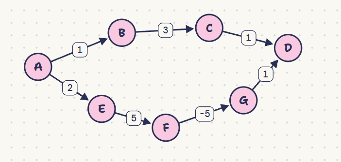
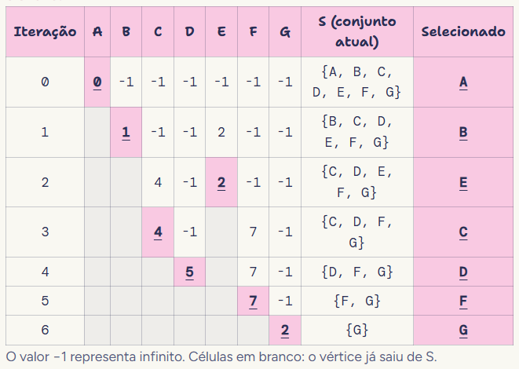

# Provações para a P2

## 01 -> : Se G = (V, E, w) é um grafo ponderado conexo onde todas as arestas possuem pesos distintos, prove que a Árvore Geradora Mínima (AGM) de G é única.

A árvore geradora mínima é um grafo acíclico conexo ponderado com a menor soma de pesos. Levando em consideração que todos os pesos são distintos, isso implica que ao selecionarmos todos os pesos das arestas e os ordenarmos, teremos apenas uma ordem possível, onde w(e1) < w(e2) < w(e3) < ... < w(en). 

Supondo duas árvores geradoras mínimas distintas, chamadas de T1 e T2, para que sejam distintas, é necessário termos pelo menos uma aresta e diferente entre as duas. Se selecionarmos a aresta de menor peso que não está presente nas duas árvores (é diferente) e ela estiver, por exemplo, apenas em T1, se adicionarmos em T2, estaremos criando um ciclo. 

Nesse ciclo, pelo menos uma das arestas presentes de T2 não pode existir em T1, pois T1 é uma árvore e logo acíclico. Isso significa que temos uma aresta f presente apenas em T2. Porém, se essa aresta f tem maior peso que a nossa aresta inicial e, removendo f, diminuímos a soma de pesos total de T2, que agora será a soma antiga - f + e. 

Mas, se T2 era uma árvore geradora mínima, T2 já tinha a menor soma de pesos possível e logo, não deveria ser possível diminuir essa soma. Assim, isso implica que não é possível, com pesos distintos, ter duas árvores geradoras mínimas distintas. 

## 02 -> Se e é a aresta de menor peso contida em um ciclo C de um grafo G, prove ou refute se e obrigatoriamente pertence a alguma AGM de G.

Se supormos que a afirmativa é falsa e que a aresta e de menor peso não está presente em nenhuma AGM, podemos adicionar essa aresta a uma árvore T1. Ao adicionarmos essa aresta e do grafo original, criaríamos um ciclo. 

Seria necessário remover alguma aresta do ciclo, de forma a transformar o grafo novamente em uma árvore geradora mínima, com a menor soma de pesos. 

Se e é a aresta de menor peso, qualquer outra aresta presente no ciclo teria peso igual ou maior a e:
w(e) =< w(f)

Logo, se removermos uma aresta f e a substituirmos por e para criar uma árvore geradora mínima T2, seu peso ficaria: 
w(T2) = w(T1) - w(f) + w(e)

Se w(e) = w(f), ficaríamos com o mesmo peso, e logo uma possível árvore geradora mínima com a aresta e. 

Se w(e) < w(f), a árvore com a aresta f não era uma AGM, pois foi possível diminuir seu peso. 

Isso mostra que a aresta de menor peso e está presente obrigatoriamente a alguma AGM. 

## 03 -> Dada uma AGM T de um grafo conexo G, prove que a remoção das k-1 arestas de maior peso de T divide o grafo em uma floresta de k componentes conexos de custo mínimo (agrupamento/clustering).

Uma árvore geradora mínima com n vértices possui n-1 arestas e nenhum ciclo com a menor soma de pesos possível. Isso significa que ao remover qualquer aresta, desconectamos o grafo em duas árvores. 

Ao remover k-1 arestas, dividimos o subconjunto de vértices em (k-1) + 1 grupos, como no exemplo abaixo.

Como T é a árvore geradora que minimiza a soma total das arestas em G, remover as k-1 arestas de maiores pesos dentro de T garante que a soma das arestas mantidas dentro dos k grupos seja minimizada, maximizando as distâncias/separação entre os k componentes formados. Porém, isso não garante que a quantidade de vértices dos grupos será a mesma ou parecida. 

## 04 -> Prove por que o Algoritmo de Dijkstra falha na presença de arestas com pesos negativos (mesmo sem ciclos negativos)

O algoritmo de Djikstra foi construído através de uma estratégia gulosa que assume que se um vértice já foi selecionado e removido do conjunto, a distância atual é definitiva e máxima, não podendo diminuir (monotonicidade de pesos não-negativos). 

Porém, em um grafo cíclico, se existirem arestas com peso negativo, um caminho futuro passando por outros vértices pode retroceder e reduzir o custo para atingir u após u já ter sido marcado como "finalizado". 

Como o Dijkstra tradicional não reavalia vértices já removidos do conjunto de busca, ele falha em encontrar o menor caminho correto

**Exemplo real:**

Nesse grafo, o menor caminho de A até D é o debaixo, com soma acumulada = 3. 
Porém, djikstra escolhe o caminho de cima, com soma acumulada = 5. Isso pode ser comprovado pelo passo a passo: 

Como djikstra não retorna a vértices já removidos de um conjunto S, ao finalizar D, na quinta iteração, Djikstra não tem a oportunidade de reatualizar D com o peso descoberto através de G e F.   
Logo, não funciona para pesos negativos.   

## 05 -> Em uma rede, cada aresta $e$ tem uma probabilidade de sucesso $p(e) \in (0, 1]$. Queremos encontrar o caminho entre $u$ e $v$ que maximiza o produto das probabilidades $\prod p(e_i)$. Prove como esse problema pode ser transformado para ser resolvido exatamente pelo Algoritmo de Dijkstra.

Como Djikstra é um algoritmo baseado numa soma de pesos, precisamos transformar a multiplicação das probabilidades (produto) para alguma função de soma, para daí podermos aplicar Djikstra. 

Como a função logarítmica ln(x) é estritamente crescente, maximizar um produto é equivalente a maximizar a soma dos logaritmos. 
Porém, para podermos aplicar Djikstra, devemos multiplicar a função por -1. 
Isso porque: 
- A multiplicação por -1 transforma a maximização na minimização que o Dijkstra faz. Como ln(p(e)) =<0, o novo peso w'(e) = -ln(p(e)) fica positivo ou zero.

Assim, podemos aplicar Djikstra. 
**Obs:** Não precisamos reverter após aplicação de Djikstra se queremos encontrar o caminho. Apenas se quisermos encontrar o valor. 

## 06 -> Prove que um grafo conexo G = (V, E) possui um ciclo euleriano (é euleriano) se e somente se todo vértice de G tem grau par.

Um grafo euleriano é um grafo em que é possível ir de um vértice inicial e voltar nele passando por todas as arestas apenas uma vez. Se durante esse processo, o grau de algum vértice for ímpar, isso significa que não há arestas suficientes para ir e voltar para esse vértice sem repetir arestas.   
Ex: se o grau de um vértice for 1, tem como chegar até esse vértice, mas não voltar.   

Considerando que cada passagem por um vértice consome duas arestas, e é necessário ter n passagens para poder retornar ao vértice inicial, a quantidade total de passagens de um vértice deve ser 2n, que só pode ser um número par. Logo, o grau do vértice é par.

Para a recíproca (provar que ter graus pares garante o ciclo), a intuição é que você pode começar a caminhar aleatoriamente pelo grafo: como todo vértice tem grau par, você nunca vai ficar preso em um beco sem saída, pois para cada aresta que você usa para entrar em um vértice, sempre há uma livre para sair. Se você voltar ao início e ainda sobrarem partes do grafo não visitadas, basta fazer um pequeno desvio a partir de um vértice do seu caminho que tenha arestas livres, completar esse loop secundário e "emendá-lo" no seu passeio principal até que absolutamente todas as arestas tenham sido percorridas exatamente uma vez.
